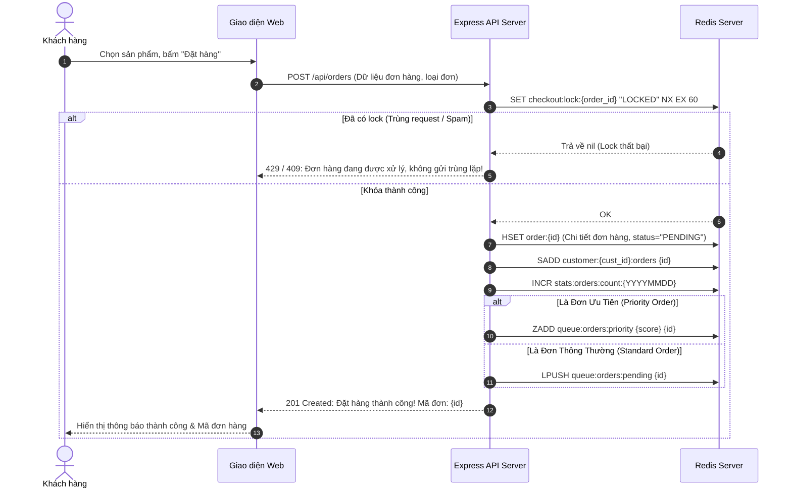
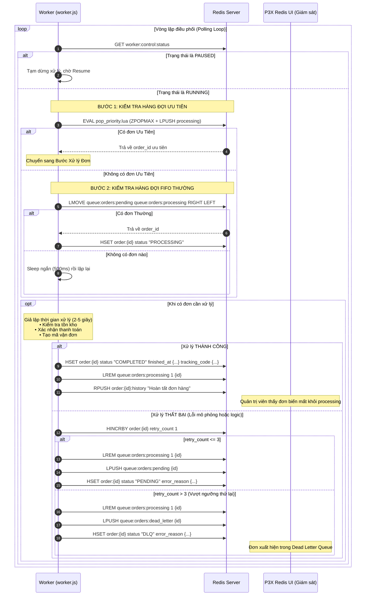
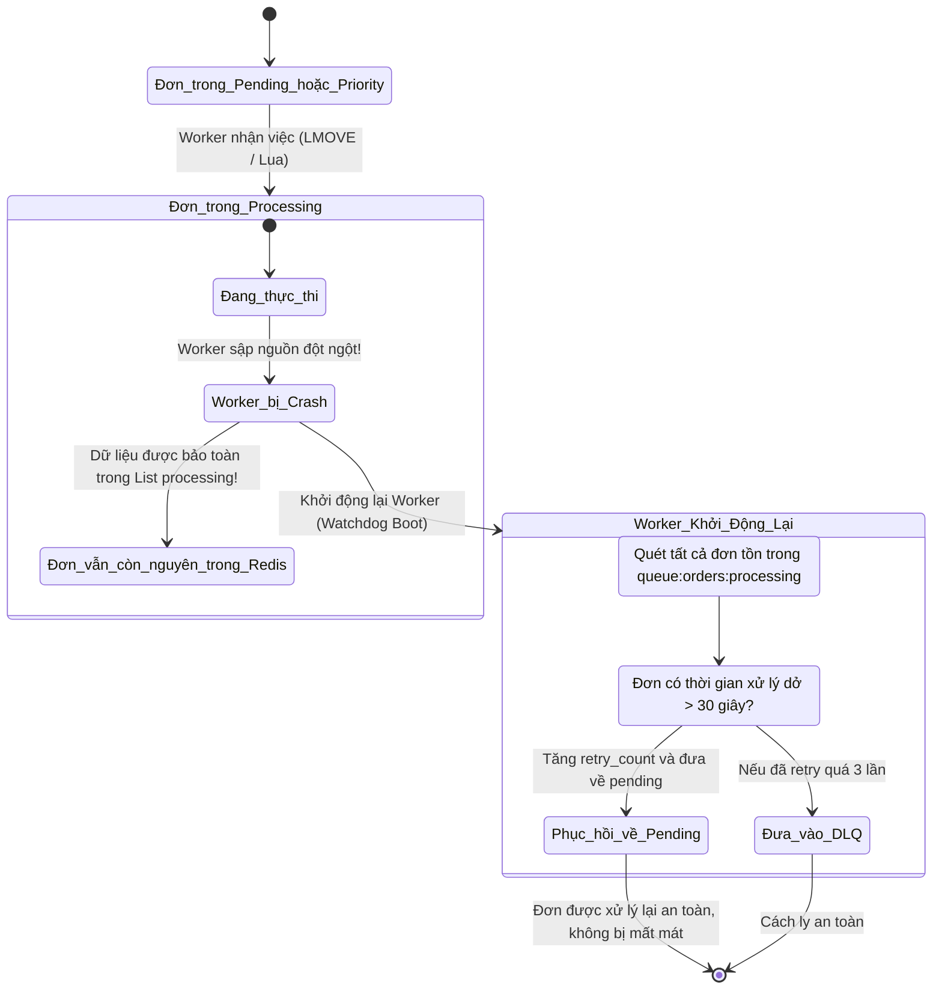

# KIẾN TRÚC HỆ THỐNG QUẢN LÝ HÀNG ĐỢI XỬ LÝ ĐƠN HÀNG TRỰC TUYẾN
## (ORDER QUEUE MANAGEMENT SYSTEM ARCHITECTURE)

> Cập nhật 26/10/2026: mã thực thi dùng `queueScripts.js` với `createOrderAtomic`, `claimOrder`, `transitionOrder`, `renewOrder`. FIFO dùng RPOP + LPUSH trong Lua cùng metadata; priority dùng ZREVRANGE + ZREM trong cùng Lua. Heartbeat lưu epoch milliseconds, token sở hữu chặn Worker cũ; lỗi/crash phục hồi theo priority và giới hạn retry cấu hình. Idempotency giữ kết quả 24 giờ theo key của client; `checkout:lock:*` chỉ giữ để quan sát TTL. Xem [CODEX_HANDOFF.md](CODEX_HANDOFF.md) cho hợp đồng hiện hành; các sơ đồ cũ bên dưới là tài liệu cần Antigravity đồng bộ.

---

## 1. Tổng Quan Kiến Trúc (High-Level Architecture)

Hệ thống được thiết kế theo mô hình **Khai thác hàng đợi phân tán bất đồng bộ (Asynchronous Distributed Queue Pattern)** nhằm tách rời hoàn toàn luồng tiếp nhận đơn hàng (Order Ingestion) và luồng xử lý đơn hàng chuyên sâu (Order Processing & Fulfillment).

Cơ sở dữ liệu trung tâm là **Redis In-Memory Database**, kết hợp với công cụ quản trị trực quan **P3X Redis UI**.

```mermaid
graph TB
    subgraph Client_Layer ["1. TẦNG KHÁCH HÀNG & QUẢN TRỊ"]
        CustomerUI["Giao diện Khách hàng (index.html)<br/>• Danh mục 10 sản phẩm<br/>• Giỏ hàng & Form đặt hàng<br/>• Tra cứu trạng thái đơn"]
        AdminDashboard["Giao diện Quản trị (admin.html)<br/>• Giám sát độ dài hàng đợi<br/>• Điều khiển Worker (Pause/Resume)<br/>• Xử lý từng đơn (Step-by-step)<br/>• Tạo batch 10/50/100 đơn & Retry DLQ"]
        P3XUI["P3X Redis UI (Cổng 7843)<br/>• Trình duyệt khóa cây (Tree View)<br/>• Console CLI nhúng<br/>• Giám sát tài nguyên máy chủ<br/>• Đối soát & Xuất JSON"]
    end

    subgraph App_Layer ["2. TẦNG ỨNG DỤNG (EXPRESS API & STATIC SERVER)"]
        APIServer["Node.js / Express Web Server (Cổng 3000)<br/>• Endpoint: /api/orders (POST - Đặt hàng)<br/>• Endpoint: /api/orders/:id (GET - Tra cứu)<br/>• Endpoint: /api/admin/* (Điều khiển & Thống kê)"]
        IdempotencyLock["Idempotency Lock Service<br/>(SET checkout:lock:{id} NX EX 60)"]
    end

    subgraph Redis_Layer ["3. TẦNG DỮ LIỆU & HÀNG ĐỢI REDIS (PORT 6379)"]
        OrderHash[("order:{order_id}<br/>Hash lưu thông tin đơn")]
        PendingQueue[("queue:orders:pending<br/>List hàng đợi FIFO")]
        PriorityQueue[("queue:orders:priority<br/>Sorted Set hàng đợi Ưu tiên")]
        ProcessingQueue[("queue:orders:processing<br/>List hàng đợi Đang xử lý")]
        DLQueue[("queue:orders:dead_letter<br/>List Dead Letter Queue")]
        CustSet[("customer:{cust_id}:orders<br/>Set đơn hàng của khách")]
        StatsCount[("stats:orders:count:{date}<br/>Atomic Counter")]
        WorkerControl[("worker:control:status<br/>Trạng thái RUNNING/PAUSED")]
    end

    subgraph Worker_Layer ["4. TẦNG XỬ LÝ NỀN ĐỘC LẬP (BACKGROUND WORKER)"]
        WorkerProcess["Worker Service (worker.js)<br/>• Chạy độc lập với Web Server<br/>• Ưu tiên quét Priority Queue trước<br/>• Quét FIFO Pending Queue bằng LMOVE<br/>• Cơ chế Retry tối đa 3 lần<br/>• Đẩy đơn lỗi vào DLQ"]
        CrashRecovery["Watchdog & Crash Recovery Engine<br/>• Quét đơn bị treo trong processing<br/>• Phục hồi khi Worker khởi động lại"]
    end

    CustomerUI -->|Gửi yêu cầu đặt hàng| APIServer
    AdminDashboard -->|Gửi lệnh điều khiển & lấy thống kê| APIServer
    APIServer --> IdempotencyLock
    IdempotencyLock --> OrderHash
    APIServer --> PendingQueue
    APIServer --> PriorityQueue
    APIServer --> CustSet
    APIServer --> StatsCount

    WorkerProcess -->|Quét & Lấy đơn ưu tiên (Lua Script)| PriorityQueue
    WorkerProcess -->|Quét & Chuyển đơn thường (LMOVE)| PendingQueue
    WorkerProcess -->|Đưa vào đang xử lý| ProcessingQueue
    WorkerProcess -->|Cập nhật trạng thái| OrderHash
    WorkerProcess -->|Đơn lỗi quá 3 lần| DLQueue
    CrashRecovery -.->|Giám sát đơn bị kẹt| ProcessingQueue

    P3XUI -->|Kết nối trực tiếp ioredis| Redis_Layer
```

---

## 2. Luồng Tiếp Nhận Đơn Hàng (Order Ingestion Flow)



---

## 3. Luồng Xử Lý Hàng Đợi của Worker (Worker Processing Lifecycle)

Worker là tiến trình nền chạy vòng lặp liên tục độc lập với Web Server:



---

## 4. Cơ Chế Phục Hồi Khi Worker Bị Dừng Đột Ngột (Crash Recovery)

Nếu Worker bị tắt (`Ctrl+C`, mất điện, Docker container restart) khi đang xử lý đơn hàng:


